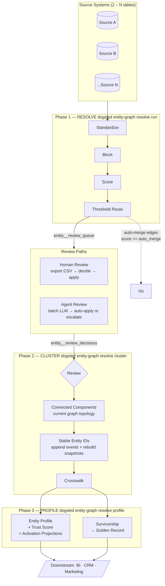
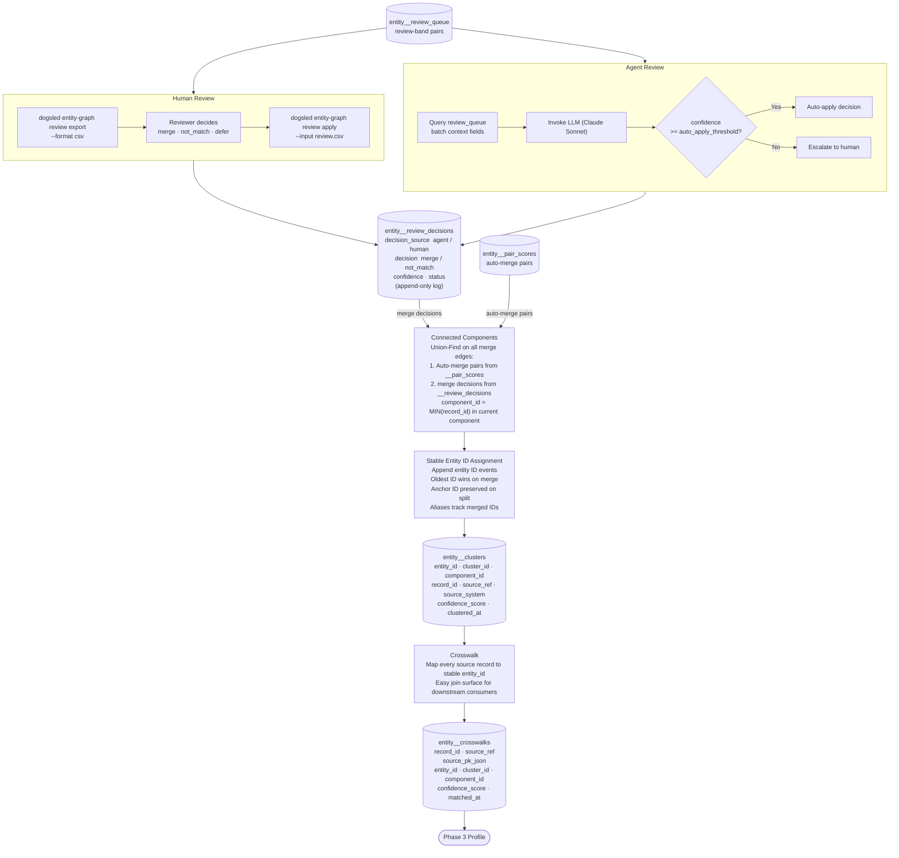
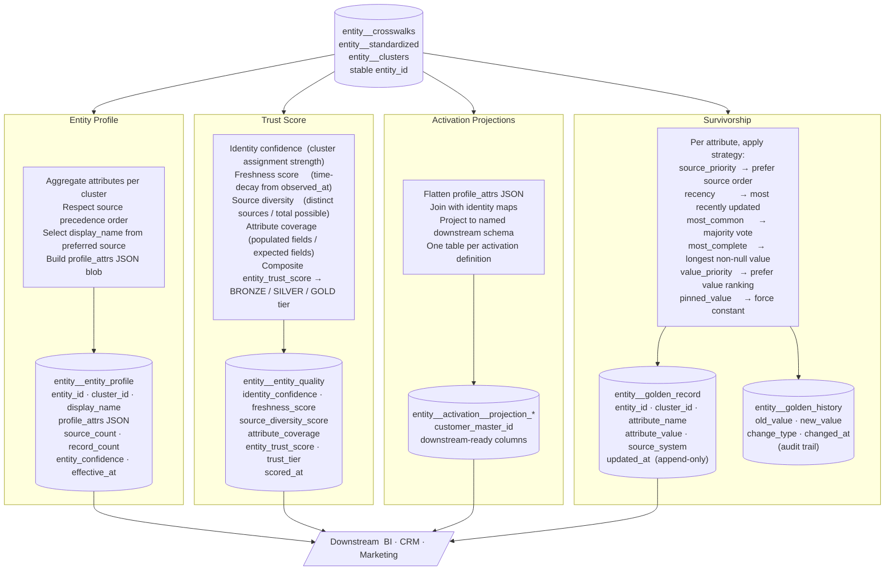

# Entity Graph Workflow Diagrams

Visual reference for the entity graph identity pipeline — phases, artifact tables, review paths, and the default company sandbox.

---

## 1. Overall Pipeline Architecture

The three execution phases, the CLI commands that trigger them, and how review decisions feed back into clustering. Current serving outputs use stable `entity_id`; `component_id` captures the current connected-component shape.



### CLI quick reference (company sandbox)

The sandbox lives in `workspace/entity-graph-demo`; run these commands from that directory.

```bash
# Phase 1 — run the full resolve pipeline (standardize → block → score → threshold)
dogsled entity-graph resolve run company --runner ./runner.duckdb.js

# Phase 2 — export the review queue, fill in decisions, re-import, then cluster
dogsled entity-graph review export company --format csv --output company_review.csv
# edit company_review.csv: set `decision` column to merge | not_match | defer
dogsled entity-graph review apply --entity company --input company_review.csv
dogsled entity-graph resolve cluster company --runner ./runner.duckdb.js

# Phase 3 — build entity profiles and golden records
dogsled entity-graph resolve profile company --runner ./runner.duckdb.js
dogsled entity-graph survivorship run company --runner ./runner.duckdb.js
```

**Spot-check queries against company sandbox tables (DuckDB / schema `entity_graph_demo`):**

```sql
-- How many standardized records per source?
SELECT _source_system, COUNT(*) FROM entity_graph_demo.company__standardized GROUP BY 1;

-- Distribution of match types from scoring
SELECT match_type, COUNT(*) FROM entity_graph_demo.company__pair_scores GROUP BY 1;

-- Review queue: top candidates by score
SELECT pair_id, composite_score, recommended_action, field_diffs
FROM entity_graph_demo.company__review_queue
ORDER BY composite_score DESC LIMIT 20;

-- Entity size distribution
SELECT entity_id, COUNT(*) AS members
FROM entity_graph_demo.company__clusters
GROUP BY 1 ORDER BY 2 DESC LIMIT 10;

-- Golden record for a specific entity
SELECT attribute_name, attribute_value, source_system
FROM entity_graph_demo.company__golden_record
WHERE entity_id = '<entity_id>';
```

---

## 2. Phase 1 — Resolve: Steps and Artifact Tables

Each step produces an intermediate table consumed by the next stage. Scoring joins back to `__standardized` for field values.

```mermaid
flowchart LR
    src["Source Tables\nUNION ALL"] --> std

    std["1 · Standardize\nNormalize per-field\nlowercase · trim · digits_only\nstrip_legal_suffixes · strip_protocol\nAdd record_id + source_ref"]

    std --> t_std[("entity__standardized\nrecord_id · source_ref\nstandardized_* fields\n_source_system\n_standardized_at")]

    t_std --> blk

    blk["2 · Block\nCompute key per rule\nOR across all rules\nPairs sharing any key → candidate\nCap at candidate_limit"]

    blk --> t_cand[("entity__candidate_pairs\nrecord_a_id · record_b_id\nsource_a · source_b\nblocking_rules JSON")]

    t_cand --> scr
    t_std --> scr

    scr["3 · Score\nDeterministic rules first:\n  if conditions fire → auto_merge\nOtherwise weighted fuzzy:\n  jaro_winkler · exact · soundex\n  numeric_distance · date_proximity\nComposite = sum of score x weight"]

    scr --> t_scores[("entity__pair_scores\npair_id · composite_score\nmatch_type · rule_name\nfield_scores JSON · blocking_rules")]

    t_scores --> thr

    thr["4 · Threshold Route\nscore >= auto_merge  → auto-merge edge\nscore >= review      → review_queue\nscore >= auto_reject → re-evaluate pool\nbelow auto_reject    → discard\nAdds recommended_action heuristic"]

    thr -->|"auto-merge edges\nto Phase 2 clustering"| clus_out(["Phase 2 Cluster"])
    thr --> t_queue[("entity__review_queue\npair_id · composite_score\nthreshold_band · field_diffs\nrecommended_action")]
```



---

## 3. Phase 2 — Review and Cluster: Steps and Artifact Tables

Auto-merge edges and review decisions are combined before clustering. Review is optional — pairs routed to the queue can be handled by human reviewers, the LLM agent, or both. The connected component is then mapped to a stable `entity_id` before serving tables are rebuilt.



---

## 4. Phase 3 — Profile and Survivorship: Steps and Artifact Tables

Profile and survivorship run from the crosswalk + standardized data. They are independent of each other and can run in parallel.


